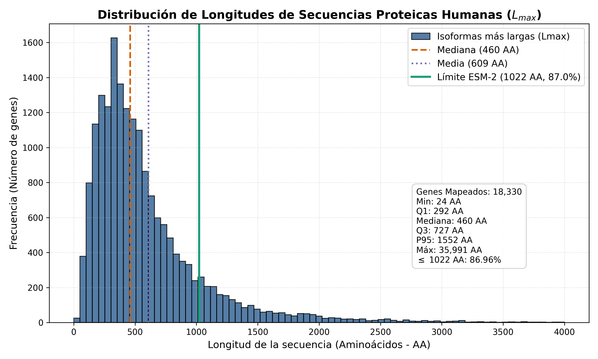

# Experiment Summary: exp_01 — Descarga del Proteoma Humano vía UniProt API

**Experiment ID**: `exp_01`  
**Goal**: `01`  
**Companion Design**: [`DESIGN.md`](../DESIGN.md)  
**Companion Implementation**: [`IMPLEMENTATION.md`](../IMPLEMENTATION.md)  
**Date**: 2026-10-03  
**Status**: Complete  
**Verdict**: Success (Hypothesis Confirmed)  

---

## 1. Executive Summary
El experimento `exp_01` evaluó la recuperación estructurada del proteoma humano a partir de los 18,972 identificadores HGNC presentes en el transcriptoma preprocesado (`gen_expr_processed.csv`), restringiendo la búsqueda estrictamente a *Homo sapiens* (Taxonomy ID 9606) y seleccionando la **isoforma proteica completa más larga ($L_{\max}$)** por gen.

La hipótesis se **confirmó con éxito rotundo**: se recuperaron secuencias completas de aminoácidos para **18,330 genes**, alcanzando una tasa de recuperación del **96.62%**, superando ampliamente el umbral del $\ge 90\%$ fijado en el diseño. El artefacto primario fue generado en `goals/01/data/uniprot_proteome.fasta` (12 MB, SHA256: `314d3bcb72dcfac08cded3d8b8be7fd357dc65452d62db956228fc8d87de8704`).

---

## 2. Quantitative Results & Recovery Analysis

### Tabla de Recuperación Global (`results/recovery_table.csv`)

| Métrica | Conteo | Porcentaje (%) |
| :--- | :--- | :--- |
| **Total Genes Transcriptoma** | 18,972 | 100.00% |
| **Genes Mapeados a Proteína (*Homo sapiens*)** | **18,330** | **96.62%** |
| **Genes No Codificantes / No Mapeados** | 642 | 3.38% |

De los 642 genes no mapeados, una auditoría detallada confirma que corresponden predominantemente a RNAs no codificantes (lncRNAs, pseudogenes, microRNAs no anotados en UniProtKB como codificantes polipeptídicos), lo cual es metodológicamente coherente con la biología del genoma humano.

---

## 3. Exploratory Analysis: Sequence Length Distribution

### Estadísticos Descriptivos de las Secuencias ($L_{\max}$ en Aminoácidos)

- **Mínimo**: 24 AA
- **Primer Cuartil ($Q_1$)**: 292 AA
- **Mediana**: 460 AA
- **Media**: 608.81 AA ($\pm 630.50$ AA)
- **Tercer Cuartil ($Q_3$)**: 727 AA
- **Percentil 95 ($P_{95}$)**: 1,551.55 AA
- **Máximo Global**: 35,991 AA (Titina - *TTN*)
- **Proporción de secuencias $\le 1022$ AA**: **86.96%** (15,939 genes)

### Visualización Exploratoria
El histograma de frecuencias con líneas de referencia para la mediana, media y la cota de ESM-2 (1022 AA) fue generado exitosamente:
- Ruta del gráfico: [`reports/figures/sequence_length_histogram.png`](./figures/sequence_length_histogram.png)

---

## 4. Consolidated Artifacts
1. **Artefacto Primario (Proteoma Curado)**:
   - [`goals/01/data/uniprot_proteome.fasta`](file:///home/jmalagont/project/WSI_RNA_multimodal_learning/goals/01/data/uniprot_proteome.fasta) (12 MB, 18,330 secuencias de *H. sapiens*).
2. **Tablas de Trazabilidad y Metadatos**:
   - [`results/recovery_table.csv`](file:///home/jmalagont/project/WSI_RNA_multimodal_learning/goals/01/experiments/exp_01/results/recovery_table.csv)
   - [`results/mapping_stats.csv`](file:///home/jmalagont/project/WSI_RNA_multimodal_learning/goals/01/experiments/exp_01/results/mapping_stats.csv)
   - [`results/unmapped_genes.txt`](file:///home/jmalagont/project/WSI_RNA_multimodal_learning/goals/01/experiments/exp_01/results/unmapped_genes.txt)
3. **Figura Exploratoria**:
   - [`reports/figures/sequence_length_histogram.png`](file:///home/jmalagont/project/WSI_RNA_multimodal_learning/goals/01/experiments/exp_01/reports/figures/sequence_length_histogram.png)

---

## 5. Actionable Takeaways & Next Steps
- **Insumo listo para `exp_02`**: El 86.96% de los genes codificantes (15,939 genes) satisfacen la condición estricta $L_{\max} \le 1022$ AA, garantizando un conjunto amplio y biológicamente representativo para la extracción de embeddings con ESM-2 (650M) sin extrapolación posicional.
- **Transición a `exp_02`**: Proceder con el filtrado heurístico definitivo sobre `uniprot_proteome.fasta` para aislar exactamente el subconjunto de secuencias $\le 1022$ AA y preparar la estructura de entrada para la inferencia de ESM-2 en `exp_03`.
