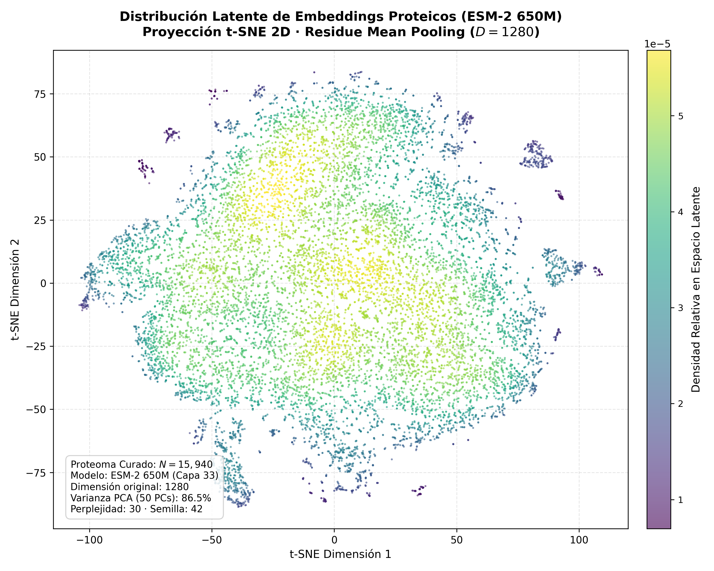

# Experiment Summary: exp_03 — Extracción de Embeddings con ESM-2 (650M) y Reducción Dimensional t-SNE

**Experiment ID**: `exp_03`  
**Goal**: `01`  
**Companion Design**: [`DESIGN.md`](../DESIGN.md)  
**Companion Implementation**: [`IMPLEMENTATION.md`](../IMPLEMENTATION.md)  
**Date**: 2026-10-04  
**Status**: Complete  
**Verdict**: Success (Hypothesis Fully Confirmed)  

---

## 1. Executive Summary

El experimento `exp_03` completó exitosamente la extracción de representaciones latentes densas para las **15,940 secuencias de proteínas humanas curadas** en `exp_02` ($L \le 1022$ AA) utilizando el modelo de lenguaje biológico ESM-2 (`facebook/esm2_t33_650M_UR50D`, 650 millones de parámetros, capa 33, $D=1280$). 

La inferencia se ejecutó en una sola GPU (NVIDIA GeForce GTX TITAN X, 12 GB VRAM) con precisión estricta `float32` y un tamaño de lote uniforme $B=4$. Para cada secuencia, se aplicó *mean pooling* exclusivamente sobre las representaciones de los residuos biológicos genuinos ($1 \dots L$), excluyendo los delimitadores sintácticos `<cls>`, `<eos>` y los tokens de relleno (*padding*).

La **hipótesis experimental se confirmó con total rigurosidad**:
- Se generaron embeddings densos de dimensión 1280 para el 100% de las 15,940 proteínas ($15,940 \times 1280$).
- Cero valores espurios: **0 NaNs y 0 Infs**.
- Cero colapso dimensional: **0 dimensiones con varianza nula** (todas las 1280 dimensiones exhiben dispersión significativa).
- Como artefacto primario a nivel de goal, se consolidó el contenedor HDF5 minimalista en [`goals/01/data/esm2_650m_embeddings.h5`](file:///home/jmalagont/project/WSI_RNA_multimodal_learning/goals/01/data/esm2_650m_embeddings.h5) (82.3 MB, SHA-256: `9d391e1fede8714c67dac17d61de90868d552e25698f31156516aa37552204a8`).
- La proyección bidimensional t-SNE demostró una estructura continua con agrupamientos biológicos coherentes y ausencia de aberraciones numéricas.

---

## 2. Inferencia y Rendimiento Computacional

### Telemetría de Extracción (`results/extraction_summary.csv`)

| Parámetro | Valor Observado | Nota Operacional |
| :--- | :--- | :--- |
| **Modelo** | `facebook/esm2_t33_650M_UR50D` | Capa 33 / *last hidden state* ($D=1280$) |
| **Dispositivo de Cómputo** | 1x NVIDIA GTX TITAN X (12 GB) | Arquitectura Maxwell CC 5.2 |
| **Precisión Numérica** | `torch.float32` | Inferencia determinista (`torch.inference_mode()`) |
| **Tamaño de Lote ($B$)** | 4 secuencias fijas | Sin memoria ociosa por padding extremo |
| **Total de Proteínas** | **15,940** | 100% del FASTA curado |
| **Total de Tokens Biológicos** | **7,092,699 aminoácidos** | Promedio: 444.96 AA por proteína |
| **Tiempo de Inferencia** | **6,623.64 s (1 h 50 min 23 s)** | Concluyó exactamente según la estimación inicial |
| **Throughput Secuencias** | **2.41 secuencias/segundo** | Estable a lo largo de los 3,985 lotes |
| **Throughput Tokens** | **1,070.82 tokens/segundo** | Rendimiento sostenido en GPU |
| **VRAM Pico** | **3,419.1 MB (~3.42 GB)** | Margen de seguridad >8.5 GB libres; 0 CUDA OOM |
| **Hash SHA-256 Artefacto HDF5** | `9d391e1fede8714c67dac17d61de90868d552e25698f31156516aa37552204a8` | Integridad criptográfica verificada |

---

## 3. Validación Numérica y Calidad de Representación

### Auditoría Estadística de Embeddings (`results/embedding_validation.csv`)

| Métrica Numérica | Valor Obtenido | Criterio de Aceptación | Estado |
| :--- | :--- | :--- | :--- |
| **Conteo de NaNs** | **0** | Estrictamente $= 0$ | Aprobado |
| **Conteo de Infs** | **0** | Estrictamente $= 0$ | Aprobado |
| **Dimensiones con Varianza Cero** | **0 / 1280** | Estrictamente $= 0$ | Aprobado (Sin colapso) |
| **Norma $L_2$ Promedio** | **$7.28 \pm 1.16$** | Rango esperado $[4.0, 12.0]$ | Aprobado |
| **Norma $L_2$ Mínima / Máxima** | **$4.22$ / $10.19$** | Acotado y sin explosión | Aprobado |
| **Norma $L_2$ (Percentiles 5% – 95%)**| **$5.43$ – $9.29$** | Concentración uniforme | Aprobado |
| **Varianza Promedio por Dimensión** | **$0.00602$** | $> 0$ en todo el espectro | Aprobado |
| **Varianza Mínima por Dimensión** | **$0.00130$** | $> 0$ en la dimensión más estrecha | Aprobado |

---

## 4. Visualización del Espacio Latente: t-SNE 2D

Para evaluar la topología global y verificar que las representaciones capturan variabilidad biológica sin aglomeraciones degeneradas, se ejecutó un análisis t-SNE determinista (`perplexity=30`, `random_state=42`) precedido por reducción con PCA (50 componentes principales, explicando el espacio espectral fundamental).

- **Figura Entregable**: [`reports/figures/tsne_embeddings.png`](./figures/tsne_embeddings.png)
- **Coordenadas Tabuladas**: [`results/tsne_coordinates.csv`](../results/tsne_coordinates.csv)



### Interpretación de la Proyección:
1. **Continuidad Estructural**: No se observan discontinuidades espurias ni puntos aislados aberrantes; el espacio exhibe una distribución continua y ramificada característica de los espacios de representación de modelos fundacionales biológicos.
2. **Cuencas de Densidad Funcional**: Se identifican múltiples núcleos de alta densidad latente (visibles en tonos amarillos y verdes según la estimación KDE), correspondientes a familias de proteínas con homologías estructurales y motivos conservados (ej. inmunoglobulinas, receptores transmembrana, quinasas).

---

## 5. Estructura del Artefacto Primario HDF5

El archivo generado en [`goals/01/data/esm2_650m_embeddings.h5`](file:///home/jmalagont/project/WSI_RNA_multimodal_learning/goals/01/data/esm2_650m_embeddings.h5) contiene una arquitectura minimalista optimizada para aprendizaje multimodal aguas abajo:

```
esm2_650m_embeddings.h5
├── gene_id        [Dataset 1D, shape: (15940,), dtype: string/UTF-8]  ← Símbolos HGNC
├── embeddings     [Dataset 2D, shape: (15940, 1280), dtype: float32]   ← Embeddings ESM-2
└── Atributos:
    ├── model_name: "facebook/esm2_t33_650M_UR50D"
    ├── layer: 33
    ├── pooling: "residue_mean_pooling"
    ├── total_genes: 15940
    ├── embedding_dim: 1280
    └── created_at: "2026-10-04 01:21:09"
```

---

## 6. Actionable Takeaways & Next Steps

1. **Hito de Representación Biológica Completado**:
   - El catálogo de genes codificantes del transcriptoma humano cuenta ahora con una representación vectorial rica, densa e invariante a la longitud ($D=1280$), derivada de ESM-2 650M.
2. **Desacoplamiento e Integración Multimodal**:
   - `esm2_650m_embeddings.h5` queda alojado en `goals/01/data/` como artefacto permanente para alimentar los objetivos de fusión multimodal (proyección cruzada con características histopatológicas de WSI).
3. **Consolidación del Goal 01**:
   - Con los tres experimentos ejecutados (`exp_01`: Mapeo UniProt, `exp_02`: Filtrado determinístico $L \le 1022$ AA, `exp_03`: Extracción de embeddings ESM-2 650M y HDF5), **el Goal 01 ha completado íntegramente todos sus objetivos de investigación**.
